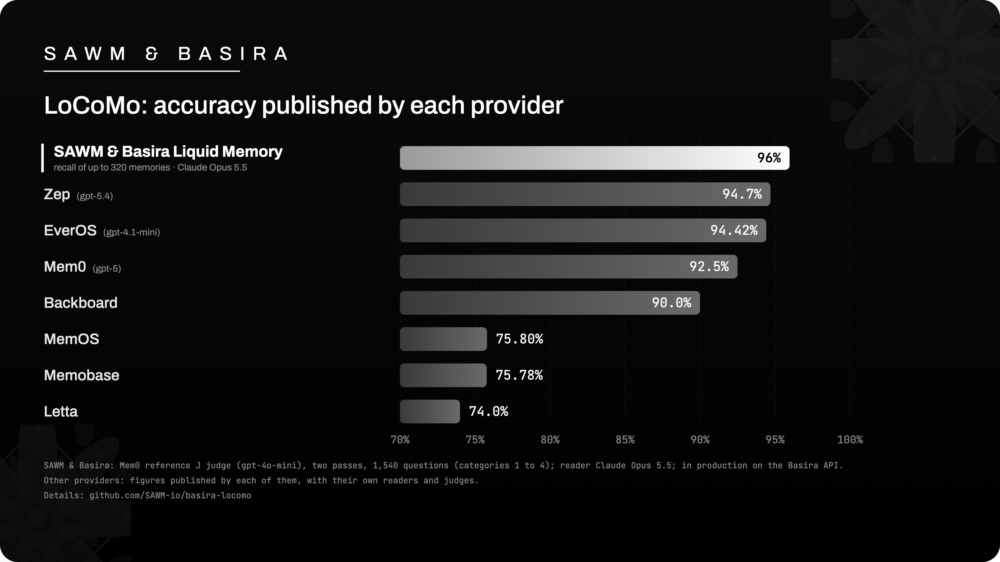

# SAWM & Basira Liquid Memory — LoCoMo

**96%** on LoCoMo with Claude Opus 5.5 (categories 1 to 4, 1,540 questions).
Mem0's reference J judge: 95.97% then 95.84% over two passes; strict GPT-4o judge: 92.08% then 91.95%.
In production on the Basira API: in this benchmark, the conversations are written and recalled through the
production API.
Every answer is published here, question by question, with the judges' verdicts: recount them yourself.

> **Summary.** SAWM & Basira Liquid Memory scores **96%** on LoCoMo with Claude Opus 5.5 (95.97% then 95.84%; categories 1 to 4,
> 1,540 questions) with the Mem0 "J" judge (`gpt-4o-mini`, official Mem0 2025 prompt), over two independent judge
> passes, and **91.9% – 92.1%** with the strict GPT-4o judge of LongMemEval. Memory written and recalled through the
> production Basira API, one memory per conversation, reader Claude Opus 5.5, single
> reading. With recall limited to 160 memories (about a quarter of the conversation) it scores 93.9%. Adversarial
> questions (category 5) are reported separately: 82.7%. On a fixed sample of 310 questions, Opus 5.5 given the full
> conversation scores 96.1%; the gap with our 320-memory recall is not statistically significant (J judge,
> -1.3 points, p = 0.29). All graded answers are published with an offline recount script. The LoCoMo data
> (CC BY-NC 4.0) is not republished.



## What LoCoMo measures

LoCoMo (Snap Research, ACL 2024) is a test of very long-term conversational memory: 10 conversations between two
people, of about 21,800 tokens each, spread over many sessions, and 1,986 questions. The questions require:

- combining information scattered across several sessions (multi-hop);
- reasoning about dates and the order of events (temporal);
- inferring what is not stated word for word (open-domain);
- retrieving a specific fact (single-hop);
- recognizing that something was never said (category 5, adversarial questions).

As with every provider that publishes LoCoMo results, the main score covers the 1,540 questions of categories 1
to 4. Category 5 is measured separately.

## Results

Reader: Claude Opus 5.5, single reading. Accuracy on the 1,540 questions of categories 1 to 4.

| Basira recall | J judge, pass 1 | J judge, pass 2 | Strict judge, pass 1 | Strict judge, pass 2 | Median context |
|---|---|---|---|---|---|
| **Liquid Memory, up to 320 memories** | **95.97% (1,478/1,540)** | **95.84% (1,476/1,540)** | 92.08% | 91.95% | ≈ 18,400 tokens (≈ 48% of the conversation) |
| Liquid Memory, up to 160 memories | 93.96% (1,447/1,540) | 93.90% (1,446/1,540) | 88.05% | 87.86% | ≈ 8,900 tokens (≈ 24%) |

The **J judge** is Mem0's judge (official Mem0 2025 prompt, `gpt-4o-mini`): it is the reference for the scores
published by the other providers. The **strict judge** is LongMemEval's judge (`gpt-4o`), which is more severe.

J judge, pass 1, by category (up to 320 memories):

| LoCoMo category | Correct | Accuracy |
|---|---|---|
| 1 · multi-hop | 270/282 | 95.74% |
| 2 · temporal | 306/321 | 95.33% |
| 3 · open-domain | 89/96 | 92.71% |
| 4 · single-hop | 813/841 | 96.67% |

Adversarial questions (category 5, 444 of 446 questions counted: see the method): **82.7%** (367/444) in pass 1,
81.5% in pass 2; 83.3% then 83.6% with 160 memories.

### What the memory returns

For each question, LoCoMo indicates the conversation turns that contain the answer. With recall of up to
320 memories, **all of these evidence turns are in what Basira returns to the reader for 95.3% of the questions**
(1,455/1,527 questions with annotated evidence), even though the reader receives only about half of the
conversation. With 160 memories (a quarter of the conversation), it is 85.1%. See the `all_evidence_returned`
field in `answers/`.

### Comparison with the full conversation

On a fixed sample of 310 questions from categories 1 to 4, Claude Opus 5.5 is given the entire conversation
(21,800 tokens): 298/310, i.e. **96.13%** (J judge). On the same 310 questions, the memory with 320 memories
(half the context) scores 94.84%: the gap (-1.3 points) is not significant (exact McNemar test,
p = 0.29, identical in both passes). With the strict judge, the gap is -1.9 points in pass 1 (p = 0.21) and
-2.6 points in pass 2 (p = 0.04). With 160 memories, the gap is -2.9 points with the J judge (p = 0.02): a
LoCoMo conversation is short, and reducing recall further costs a few points there. The details are in
`judge/recount.py`.

### Scores published by other providers

Figures published by each provider, categories 1 to 4, each with its own reader and its own judge
(the protocols are not identical):

| Provider | Published score |
|---|---|
| **SAWM & Basira Liquid Memory (320 memories)** | **95.8 – 96.0%** (J judge, reader Opus 5.5) |
| Zep | 94.7% (2026, gpt-5.4) |
| EverOS | 94.42% (gpt-4.1-mini, gpt-4o-mini judge) |
| **SAWM & Basira Liquid Memory (160 memories)** | **93.9%** |
| Mem0 | 92.5% (2026, gpt-5; 91.6% in its published files) |
| Backboard | 90.0% (GPT-4.1 judge) |
| MemOS | 75.80% |
| Memobase | 75.78% |
| Letta | 74.0% |

## Method

- **Dataset**: LoCoMo, 10 conversations and 1,986 questions, published by Snap Research. The categories (1 multi-hop,
  2 temporal, 3 open-domain, 4 single-hop, 5 adversarial questions) are part of the public dataset and are published
  here with the official key of each question (`conv-NN:qa-NN`).
- **Memory**: a fresh Basira memory per conversation. The conversation is written into it, then recall is performed
  through the production Basira API. The reader sees only what Basira
  recalls.
- **Recall**: up to 320 memories, or up to 160.
- **Reader**: Claude Opus 5.5, single reading, no second attempt.
- **Context**: median, over the 1,540 questions of categories 1 to 4, of the tokens given to the reader (GPT-4o's
  o200k tokenizer).
- **Judges**: Mem0's J judge (`gpt-4o-mini-2024-07-18`, official Mem0 2025 prompt) and LongMemEval's strict judge
  (`gpt-4o-2024-08-06`), temperature 0; two independent passes over the same answers. The prompts are taken from
  their authors' repositories at pinned versions (see [`judge/REFERENCES.md`](judge/REFERENCES.md)).
- **Category 5**: measured separately, with LongMemEval's abstention judge. Two questions from conversation 26
  (reported in issue #43 of the LoCoMo repository: an answer exists in the transcript) are left out: 444
  questions counted out of 446. They remain in the files, marked `"excluded": true`.
- **Control**: Opus 5.5 with the full conversation, on a fixed sample of 310 questions from categories 1
  to 4 (and 90 from category 5), same prompt, same judges.

## Recount it yourself

Each line of `answers/*.jsonl` contains the official key of the question, its category, the reader's answer,
the context provided (in tokens and as a share of the conversation) and the judges' verdicts. The text of the
questions and of the conversations is not republished.

```sh
cd judge
python3 -I recount.py                 # every file in ../answers
python3 -I recount.py ../answers/recall-320_opus-5.5_judge-pass1.jsonl
```

The script, with no dependencies and no key, reproduces every figure above: accuracy by judge and by pass, by
category, category 5, median context, Wilson interval and the comparison with the full conversation. The
checksums of all published files are in [`SHA256SUMS`](SHA256SUMS).

## Files

| File | Contents |
|---|---|
| `results.json` | the figures above, machine-readable |
| `answers/recall-320_*`, `recall-160_*` | the 1,986 graded answers, per judge pass |
| `answers/full-conversation-310_*` | the control's answers (400 questions), per judge pass |
| `judge/recount.py` | offline recount, no key needed |
| `judge/REFERENCES.md` | the judges' official prompts: pinned versions and checksums |
| `assets/locomo-leaderboard.png` | the leaderboard above |

## Credits and licenses

LoCoMo is the work of Adyasha Maharana and co-authors, Snap Research (*Evaluating Very Long-Term Conversational
Memory of LLM Agents*, ACL 2024): [github.com/snap-research/locomo](https://github.com/snap-research/locomo), dataset
under the CC BY-NC 4.0 license. **The dataset is not republished here** (neither conversations nor questions):
download it from its authors. The J judge is [Mem0](https://github.com/mem0ai/mem0)'s (Apache-2.0) and the strict
judge is [LongMemEval](https://github.com/xiaowu0162/LongMemEval)'s (MIT), referenced and not copied. SAWM's code
and answers are under the MIT license (`LICENSE`).

---

[SAWM](https://sawm.io) · Basira Memory — memory for AI agents.
