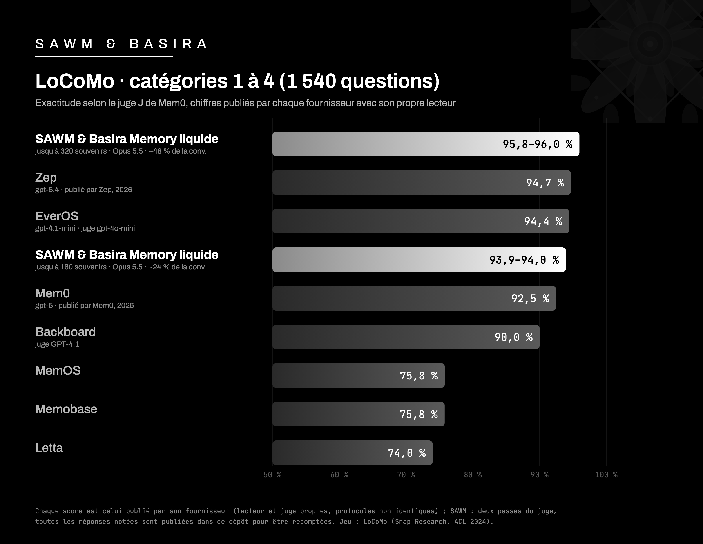

# SAWM & Basira Memory liquide — LoCoMo

**95,8 % – 96,0 %** sur LoCoMo (catégories 1 à 4, 1 540 questions), notés par le juge J de Mem0.
En production sur l'API Basira : l'écriture des conversations et le rappel de ce banc
passent par l'API de production.
Chaque réponse est publiée ici, question par question, avec les verdicts des juges : recomptez-les vous-même.

> **English summary.** SAWM & Basira Memory liquide scores **95.8 % – 96.0 %** on LoCoMo (categories 1 to 4,
> 1,540 questions) with the Mem0 "J" judge (`gpt-4o-mini`, official Mem0 2025 prompt), over two independent judge
> passes, and **91.9 % – 92.1 %** with the strict GPT-4o judge of LongMemEval. Memory written and recalled through the
> production Basira API, one memory per conversation, reader Claude Opus 5.5, single
> reading. With recall limited to 160 memories (about a quarter of the conversation) it scores 93.9 %. Adversarial
> questions (category 5) are reported separately: 82.7 %. On a fixed sample of 310 questions, Opus 5.5 given the full
> conversation scores 96.1 %; the gap with our 320-memory recall is not statistically significant (J judge,
> -1.3 points, p = 0.29). All graded answers are published with an offline recount script. The LoCoMo data
> (CC BY-NC 4.0) is not republished.



## Ce que mesure LoCoMo

LoCoMo (Snap Research, ACL 2024) est un test de mémoire conversationnelle à très long terme : 10 conversations
d'environ 21 800 jetons chacune entre deux personnes, étalées sur de nombreuses sessions, et 1 986 questions. Elles
demandent de :

- rassembler des informations dispersées dans plusieurs sessions (multi-sauts) ;
- raisonner sur les dates et l'ordre des événements (temporel) ;
- déduire ce qui n'est pas dit mot pour mot (domaine ouvert) ;
- retrouver un fait précis (simple saut) ;
- savoir dire que cela n'a pas été dit (catégorie 5, questions pièges).

Comme tous les fournisseurs qui publient sur LoCoMo, le score principal porte sur les 1 540 questions des
catégories 1 à 4. La catégorie 5 est mesurée à part.

## Résultats

Lecteur : Claude Opus 5.5, une seule lecture. Exactitude sur les 1 540 questions des catégories 1 à 4.

| Rappel de Basira | Juge J, passe 1 | Juge J, passe 2 | Juge strict, passe 1 | Juge strict, passe 2 | Contexte médian |
|---|---|---|---|---|---|
| **Memory liquide, jusqu'à 320 souvenirs** | **95,97 % (1 478/1 540)** | **95,84 % (1 476/1 540)** | 92,08 % | 91,95 % | ≈ 18 400 jetons (≈ 48 % de la conversation) |
| Memory liquide, jusqu'à 160 souvenirs | 93,96 % (1 447/1 540) | 93,90 % (1 446/1 540) | 88,05 % | 87,86 % | ≈ 8 900 jetons (≈ 24 %) |

Le **juge J** est celui de Mem0 (consigne officielle Mem0 2025, `gpt-4o-mini`) : c'est celui qui sert de référence
aux scores publiés par les autres fournisseurs. Le **juge strict** est celui de LongMemEval (`gpt-4o`), plus sévère.

Juge J, passe 1, par catégorie (jusqu'à 320 souvenirs) :

| Catégorie LoCoMo | Justes | Exactitude |
|---|---|---|
| 1 · multi-sauts | 270/282 | 95,74 % |
| 2 · temporel | 306/321 | 95,33 % |
| 3 · domaine ouvert | 89/96 | 92,71 % |
| 4 · simple saut | 813/841 | 96,67 % |

Questions pièges (catégorie 5, 444 questions comptées sur 446 : voir la méthode) : **82,7 %** (367/444) en passe 1,
81,5 % en passe 2 ; 83,3 % puis 83,6 % avec 160 souvenirs.

### Comparaison avec la conversation complète

Sur un échantillon fixe de 310 questions des catégories 1 à 4, Claude Opus 5.5 reçoit la conversation entière
(21 800 jetons) : 298/310, soit **96,13 %** (juge J). Sur ces mêmes 310 questions, la mémoire à 320 souvenirs
(moitié moins de contexte) obtient 94,84 % : l'écart (-1,3 point) n'est pas significatif (test exact de McNemar,
p = 0,29, identique aux deux passes). Avec le juge strict, l'écart est de -1,9 point en passe 1 (p = 0,21) et de
-2,6 points en passe 2 (p = 0,04). Avec 160 souvenirs, l'écart est de -2,9 points avec le juge J (p = 0,02) : une
conversation LoCoMo est courte, et réduire encore le rappel y coûte quelques points. Le détail est dans
`juge/recompter.py`.

### Scores publiés par les autres fournisseurs

Chiffres publiés par chaque fournisseur, catégories 1 à 4, chacun avec son propre lecteur et son propre juge
(les protocoles ne sont pas identiques) :

| Fournisseur | Score publié |
|---|---|
| **SAWM & Basira Memory liquide (320 souvenirs)** | **95,8 – 96,0 %** (juge J, lecteur Opus 5.5) |
| Zep | 94,7 % (2026, gpt-5.4) |
| EverOS | 94,42 % (gpt-4.1-mini, juge gpt-4o-mini) |
| **SAWM & Basira Memory liquide (160 souvenirs)** | **93,9 %** |
| Mem0 | 92,5 % (2026, gpt-5 ; 91,6 % dans ses fichiers publiés) |
| Backboard | 90,0 % (juge GPT-4.1) |
| MemOS | 75,80 % |
| Memobase | 75,78 % |
| Letta | 74,0 % |

## Méthode

- **Jeu** : LoCoMo, 10 conversations et 1 986 questions, publié par Snap Research. Les catégories (1 multi-sauts,
  2 temporel, 3 domaine ouvert, 4 simple saut, 5 questions pièges) font partie du jeu public et sont publiées ici
  avec la clé officielle de chaque question (`conv-NN:qa-NN`).
- **Mémoire** : une mémoire Basira neuve par conversation. La conversation y est écrite, puis le rappel est fait
  par l'API Basira de production. Le lecteur ne voit que ce que Basira
  rappelle.
- **Rappel** : jusqu'à 320 souvenirs, ou jusqu'à 160.
- **Lecteur** : Claude Opus 5.5, une seule lecture, sans second essai.
- **Contexte** : médiane, sur les 1 540 questions des catégories 1 à 4, des jetons fournis au lecteur (tokenizer
  o200k de GPT-4o).
- **Juges** : le juge J de Mem0 (`gpt-4o-mini-2024-07-18`, consigne officielle Mem0 2025) et le juge strict de
  LongMemEval (`gpt-4o-2024-08-06`), température 0 ; deux passes indépendantes sur les mêmes réponses. Les
  consignes sont lues chez leurs auteurs à des versions figées (voir [`juge/REFERENCES.md`](juge/REFERENCES.md)).
- **Catégorie 5** : mesurée à part, avec le juge d'abstention de LongMemEval. Deux questions de la conversation 26
  (signalées par l'issue n° 43 du dépôt LoCoMo : une réponse existe dans la transcription) sont écartées : 444
  questions comptées sur 446. Elles restent dans les fichiers, marquées `"retiree": true`.
- **Témoin** : Opus 5.5 avec la conversation complète, sur un échantillon fixe de 310 questions des catégories 1
  à 4 (et 90 de la catégorie 5), même consigne, mêmes juges.

## Recomptez vous-même

Chaque ligne de `reponses/*.jsonl` contient la clé officielle de la question, sa catégorie, la réponse du lecteur,
le contexte fourni et les verdicts des juges. Le texte des questions et des conversations n'est pas republié.

```sh
cd juge
python3 -I recompter.py                 # tous les fichiers de ../reponses
python3 -I recompter.py ../reponses/rappel-320_opus-5.5_juge-passe1.jsonl
```

Le script, sans dépendance ni clé, redonne tous les chiffres ci-dessus : exactitude par juge et par passe, par
catégorie, catégorie 5, contexte médian, intervalle de Wilson et comparaison avec la conversation complète. Les
empreintes de tous les fichiers publiés sont dans [`SHA256SUMS`](SHA256SUMS).

## Fichiers

| Fichier | Contenu |
|---|---|
| `resultats.json` | les chiffres ci-dessus, lisibles par une machine |
| `reponses/rappel-320_*`, `rappel-160_*` | les 1 986 réponses jugées, par passe du juge |
| `reponses/conversation-complete-310_*` | les réponses du témoin (400 questions), par passe du juge |
| `juge/recompter.py` | recomptage hors ligne, sans clé |
| `juge/REFERENCES.md` | consignes officielles des juges : versions figées et empreintes |
| `assets/classement-locomo.png` | le classement ci-dessus |

## Crédits et licences

LoCoMo est l'œuvre d'Adyasha Maharana et de ses coauteurs, Snap Research (*Evaluating Very Long-Term Conversational
Memory of LLM Agents*, ACL 2024) : [github.com/snap-research/locomo](https://github.com/snap-research/locomo), jeu
sous licence CC BY-NC 4.0. **Le jeu n'est pas republié ici** (ni conversations, ni questions) : téléchargez-le chez
ses auteurs. Le juge J est celui de [Mem0](https://github.com/mem0ai/mem0) (Apache-2.0) et le juge strict celui de
[LongMemEval](https://github.com/xiaowu0162/LongMemEval) (MIT), référencés et non recopiés. Le code et les réponses
de SAWM sont sous licence MIT (`LICENSE`).

---

[SAWM](https://sawm.io) · Basira Memory — la mémoire des agents IA.
